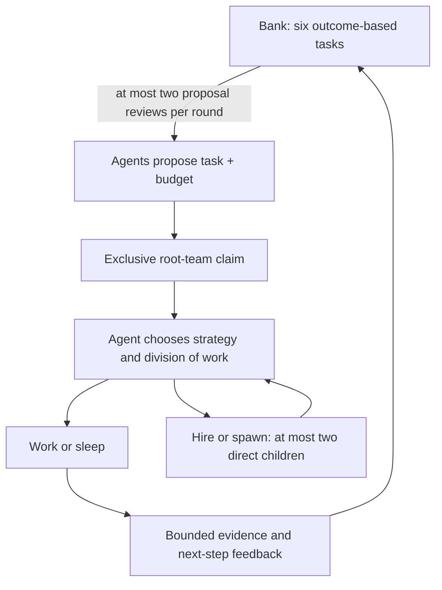
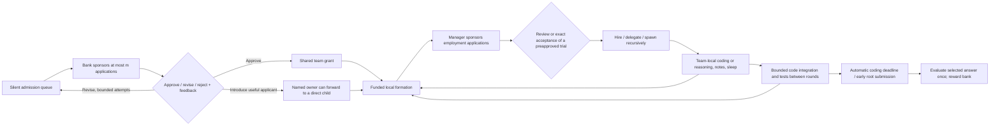
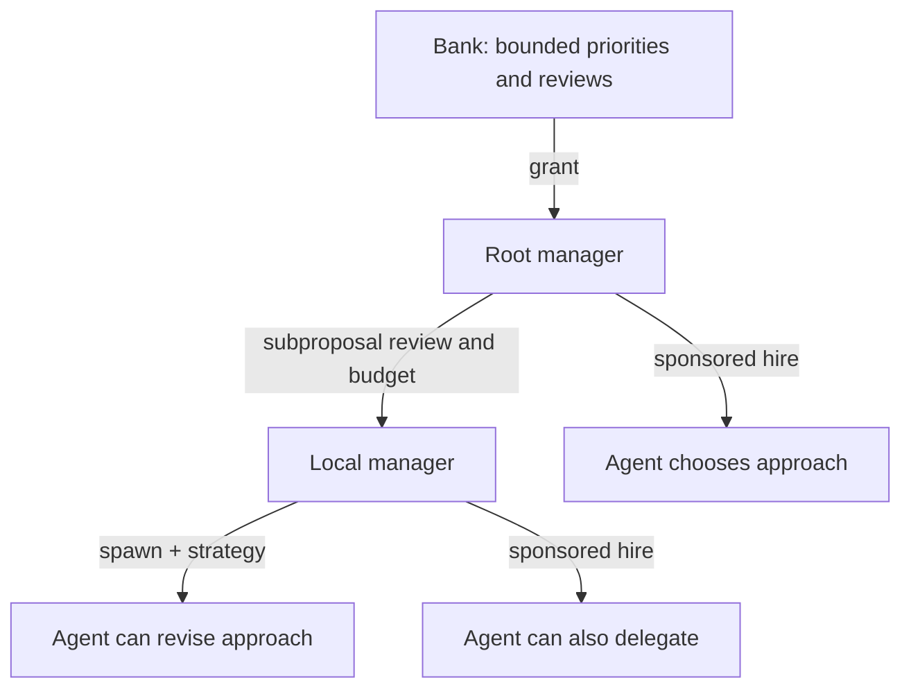

# Ant colony: sponsored, recursive collaboration

A cooperative Economy of Minds research prototype in its own folder. The bank
sets priorities and funds proposals. Every funded agent can review subproposals,
hire, spawn, and delegate through the same bounded local contract. Everyone aims
to maximize **bank money + all team money after generation costs**. Agents have
spending rights, not personal wealth; there are no bids or free birth endowments.

Derived from [zhentingqi/EoM](https://github.com/zhentingqi/EoM), pinned to
`d272266f7d6a0c302b7af5d20f1326b63c5656fb`. The original `BaseAgent`, `BaseEnv`,
`Population`, and researchworld evaluator remain directly reused. The copied
auction engine is retained for reference; `ant_colony/engine.py` and `funding.py`
implement the cooperative loop. See [provenance](vendor/NOTICE.md),
[design](DESIGN.md), and [validation](VALIDATION.md).

The completed six-run Luna/TinyDB comparison passes 75, 61 and 158 of 201 tests
with the board, versus 23, 31 and 41 without it. Board runs have zero integration
conflict events versus thirty in the controls, at about 6.7% higher API cost.
They remain single-agent teams: recursive colony emergence is not demonstrated.
See [the full experiment report](VALIDATION.md#completed-v3-comparison) for costs,
bounded-context checks, interrupted attempts and limitations.

## Short bank board, agent-chosen roles

The coding board preset is `configs/commit0-board.json`. The bank publishes at
most **six tasks**, each with a stable ID, scope, acceptance check, status and
short feedback. Agents voluntarily propose a task ID and budget. The bank sees
two proposals per round and at most two compact progress receipts; it can approve,
request a complementary scope, or suggest joining an existing owner.

The runtime allows one active root-team claim per task and one active task per
root. Two approvals for the same task cannot create duplicate grants. Same-task
top-ups remain possible. Different IDs can still describe overlapping work:
semantic redundancy is the bank's judgment, not an automatic guarantee.
Completed or explicitly reopened tasks suspend their former team's work until
another task is granted. Closing a team releases its claim. Board completion
does not mint reward: only the environment's final evaluation does.

**There are no predefined worker roles.** All initial workers have the same
capabilities and generic starting strategy. An agent can replace its own strategy,
propose a responsibility, hire another agent, or choose a new child's strategy.
Any funded agent can manage up to two direct children recursively. Budget manager
is an accounting responsibility, not a permanent specialist class. The replay
shows chosen strategies and assignments alongside the actual recruitment tree.



The bank makes one paid planning call before initial applications, then reuses
the round's paid review call to maintain the board even without new proposals.
Workers receive this fixed-size board, not every agent's plans or a global
transcript. Root tasks should be broad enough for local recursive decomposition.
The board limits strategic bandwidth; it does not promise constant total work
or remove the bank's approval bottleneck. Set `bank_board_size: 0` for the
historical board-free protocol and controlled ablations.

## The sponsored round protocol

All initial agents have zero spending rights. **Unfunded agents make no social or
work calls.** A call requires the agent's own allowance or explicit sponsorship.



1. **Admission and formation.** A rotating queue admits at most `bank_contacts`
   eligible free agents/root managers. The bank sponsors a short application for
   an unfunded admitted agent; everyone else waits without polling. Funded awake
   agents pay for their own formation calls and meet at most `peer_contacts`
   external peers. Children apply to their direct parent, never directly to the
   bank. Membership changes happen only at this boundary.
2. **Employer sponsorship.** A funded agent can open one bounded job listing.
   It authorizes at most one matched free applicant per round while open.
   A listing can name a candidate; otherwise a host-side index matches declared
   scope using a bounded shortlist, including local introductions. Screening and
   review consume the employer's allowance; approval delegates working capital
   from that same allowance. An optional `trial: true` listing preapproves one
   exact assignment and allowance: explicit acceptance on unchanged terms hires
   without a second review call. Changed terms require review. The applicant
   can decline; silence never consents. Before screening, the manager must afford
   the offer, application, any required review, and retained coordination runway.
   A bank-rejected applicant can still be hired. An applicant can also choose
   employment instead of continuing a bank revision when it receives a sponsored
   local opportunity.
3. **Review at every level.** Bank and managers return `approve`, `revise`, or
   `reject`, with brief actionable feedback. The bank sees at most `m` proposals;
   each manager sees at most `manager_contacts`. An application retains only its
   latest plan and feedback. Default: one initial submission plus two revisions.
   A rejected bank application does not automatically resubmit. Bank-funded
   application generations have a fixed episode-wide pool; bank review calls
   are separately charged to the treasury. The pool is a spending ceiling, not
   a second wallet or protected endowment.
4. **Funding.** An approved bank applicant becomes the root budget manager.
   Existing roots may request top-ups; children request additional rights from
   their parent. Grants and allocations transfer existing credits. Bank feedback
   can include a short strategic brief visible in later bounded observations.
5. **Work.** Each awake funded member has at most `work_turns` calls per round.
   It may reason, replace bounded memory/scratchpad entries, message its direct
   parent/children or listed work peers (including other teams), delegate/reclaim
   rights, spawn one child per turn, or sleep. Work peers use the existing
   `peer_contacts` cap and rotate among funded workers each round; contacts stay
   fixed across the round's work calls. Scratchpads remain team-local.
   A newborn receives existing rights and starts **next round**. Hiring and
   spawning count toward the same direct-child cap. A wave's responses are
   collected before applying actions, so same-wave model call order gives no
   earlier access to another response.
6. **Publication and completion.** Roots can publish short unverified findings
   for the next formation phase. Coding runs integrate up to `bank_contacts`
   changed team branches at each round boundary, using rotating admission and
   base-hash conflict checks. At the deadline, the latest public checkpoint is
   selected automatically. Roots can instead submit early; simultaneous early
   submissions use rotating priority **before grading**. Text/research tasks
   still require an explicit answer. Reward enters the bank once. Expired/closed
   grants and unused funds return to the bank. Evaluation failures retain a
   missing score rather than inventing zero.

Any funded agent can become a local manager. Job review is not restricted to
root managers. Managers control local execution; the deterministic scheduler
only enforces admission, legal actions, budgets, and round barriers.

The bank can attach `introduce_to` to a free applicant's revise/reject decision.
This places the latest bounded proposal in a named funded owner's introduction
queue, without a call or a transfer of money. An owner can offer scoped work or
forward the introduction to a direct child, including when its own child slots
are full. Each owner holds at most `manager_contacts` introductions. Referrals
expire, forwarding preserves the deadline, and a pending referral keeps the
applicant out of duplicate bank admission. Each applicant still needs explicit
employer sponsorship before generating an acceptance or counterproposal.

Recruitment budget options show child working capital, screening/review costs,
and the manager's own two-work-call runway. These are conservative reservation
examples within existing grants, not additional funds or protected earmarks.
Trial listings are consumed by a hire and can be cancelled before acceptance;
trial members follow normal work, renewal, and leave rules, with no automatic
membership expiry. Agents choose useful outcomes and collaborators themselves;
the mechanism assigns no specialist roles or required team size.

A funded agent can submit one `recruitment_request` during paid formation even
when it can afford its own work. It names a hire or spawn, model, allowance,
distinct outcome, and cost justification. The runtime computes the shortfall
including child capital, the owner's work and coordination runway, screening,
review, and pending direct-child commitments. That amount enters the existing
bounded parent review queue (or bank queue for a root); it creates no money or
automatic hire. Small top-ups are allowed for existing funded agents. After
approval the agent must still choose an opening or spawn, and hires still require
consent. Requests expire on time, membership, or assignment changes and can be
cancelled. No extra polling call is introduced.

If a bank review would exceed its input bound, verbose execution output and then
public probe failure details become optional context. The required receipt keeps
exit codes, revisions, counts, scores, and failure identities; proposal and budget
facts are never shortened. The context limit remains enforced.

The prompt asks every worker to own an outcome, consider independent parallel
subwork, specify interfaces and acceptance criteria, and integrate collaborators'
results. The same authority applies recursively, including to trial hires.
Operating renewals preserve the existing assignment. Under funding recovery,
rejection of an existing funded worker's top-up causes a review cooldown rather
than permanently preventing later funding. Recruitment remains voluntary and
must justify its generation, communication, and integration costs.

## Constant local context, recursive growth



| Resource | Default bound |
|---|---:|
| Initial / maximum living agents | 6 / 128 |
| Bank applications/reviews per round | 2 |
| Reviews per local manager per round | 2 |
| Pending introductions per local manager | 2 |
| Sponsored external applicants per manager per round | 1 |
| Indexed candidate shortlist per opening | 2 |
| Rotating peer contacts per agent (formation / work) | 2 / 2 |
| Direct children, hires and births combined | 2 |
| Recruitment depth | 8 |
| Work calls per awake agent per round | 2 |
| Revisions after the initial proposal | 2 |
| Bank-sponsored application pool | 12,000 credits |
| Complete serialized input messages | 24,000 UTF-8 bytes |
| Output per call | 768 tokens |
| Memory/message/scratchpad entry | 900 bytes |
| Scratchpad excerpts / inbox entries | 3 / 8 |

Agents see local neighbors, a bounded work-peer list, their own rights, selected team notes, and a scalar
society-wealth signal. They never receive the full population roster or an
unbounded transcript. The byte bound includes rules, task, schema, strategy,
feedback and tool results. It is **not** an exact model-token limit. Oversized
required input fails before inference; optional old messages/notes are omitted.
Coding observations also expose up to sixteen current file hashes. Agents can
copy one into an optimistic write after inspecting with `exec`; they need not
reread a file solely to obtain its hash. Stale writes remain rejected, and hashes
for other paths remain available through explicit reads.

Sleeping or waiting does not invoke an LLM. Events/timers can wake an agent but
do not grant free communication. `sleep: 2` in round 1 wakes in round 4 unless an
intervening message/allocation/grant wakes it earlier. The decision to sleep costs
tokens. Leaf agents may leave/retire; a root may close its entire team.

Per-agent context stays bounded as population grows. Total model work scales
with funded active agents and sponsored applications; host bookkeeping includes
sorting the population and indexing bounded declared-scope keywords once per
formation phase. Matching does not require another model call or expose the
population roster. The bounded bank remains a throughput bottleneck, making
internal delegation important. Inference is sequential in this prototype.

## Money and actual API spending

The ProgramBench campaign ledger persists its authorized ceiling across runs.
It defaults to $100; the user's October 11 amendment raised this campaign's total
to $500, including every earlier receipt and unresolved reservation. Individual
experiment ceilings remain separate (the recruitment restart retains $15).
An observed transport timeout now stops its own episode and holds the full
maximum charge indefinitely, without replaying the request or cancelling unrelated
experiments. Unknown billing failures, actual price/usage violations, and failed
accounting checks retain a global stop. This does not claim that a timeout was free.

For recruitment, prefer an opening without a named candidate unless acting on a
specific introduction or agreed collaboration. The matcher can then select an
available applicant, reducing contention for the same nearby ID. Useful next
comparisons include larger fixed review/child caps, staged delegation budgets,
and renewal conditioned on verified progress. Judge these by verified contribution
and score per dollar, not by population or tree depth alone. Fixed caps preserve
bounded per-agent context, although larger constants still increase cost and
coordination load.

```text
W = bank + sum(team wallets)
sum(member allowances in a team) = team wallet
W_end = W_start + terminal reward - generated-token costs - optional rent
```

All generation is charged, including applications, rejected/malformed responses,
feedback, coordination, work and rubric evaluation. A call must be able to reserve
its maximum output allowance before sending; it pays actual reported output.
Reasoning tokens already included in completion usage are not charged twice.
Input tokens are recorded and cost real API dollars, but the requested virtual
objective charges generated tokens only. Uniform credits across model tiers do
not guarantee minimum dollar spending.

Bank and worker observations include the maximum terminal reward, its normalized
score formula, token price, and rent. This gives them the public payoff schedule
needed to compare additional work with saving credits, without revealing a
private reference answer.

`rent_per_round` defaults to zero and can be enabled as an ablation. It creates no
debt. Research tasks protect one maximum-output evaluator call in the bank.
Real API dollars have a separate cap with durable reservations before I/O. Unknown
billing stops the run and retains the reservation. There are no automatic HTTP
retries or automatic paid-run resumptions. `audit` independently reconstructs
money, usage, application sponsorship and the application pool from events.

## Run the free demo and tests

Python 3.11+:

```sh
cd /Users/baiyu/Documents/ChatGPT/Multiagent/ant-colony
python3 -m venv .venv
.venv/bin/python -m pip install -e '.[dev]'
.venv/bin/python -m ant_colony demo --config configs/demo.json --out runs/my-demo
.venv/bin/python -m ant_colony audit runs/my-demo
.venv/bin/python -m ant_colony replay runs/my-demo --round 5
.venv/bin/pytest -q
.venv/bin/ruff check ant_colony tests scripts
.venv/bin/python scripts/scaling_smoke.py --populations 10 100 1000 --out runs/scaling.json
```

Output directories must be new. Open the generated `replay.html` to inspect
proposals, feedback, sponsorship, grants and recruitment. The demo is scripted,
with estimated tokens: it tests the protocol, not LLM quality or emergence.

## Real text/research runs

Copy `configs/models.example.json`, replace placeholder model IDs and set verified
price/input ceilings. Set `OPENROUTER_API_KEY` in the process environment:

```sh
.venv/bin/python -m ant_colony run \
  --config configs/demo.json --models configs/models.local.json \
  --tasks examples/tasks.jsonl --task-id sum-100 \
  --max-usd 1.00 --out runs/live-sum
```

Model aliases determine the bank and allowlisted worker/spawn choices. Task JSONL
contains `id`, `problem`, and `answer` for exact tasks, or `rubric` for research.
Only the evaluator sees the reference. Private task material remains in local
prompt logs. The provider uses OpenRouter's fixed HTTPS endpoint, no executable
server tools, no redirects/fallbacks, and configured price ceilings.

## Commit-0 coding tests

The adapter accepts a prepared Commit0 `task.json` plus its original `seed/`,
`SPEC.md`, and dataset row. Each root team starts a private branch from the latest
public checkpoint; hired/spawned members share that team's files. At round
boundaries, a constant number of changed branches can contribute to the shared
implementation. A bounded Python syntax precheck rejects an invalid update as
a whole, preserving the public artifact and reporting the error to its team.
Conflicting files retain local edits and require explicit
resolution; untouched files receive public updates. The runtime never picks a
branch by its test score. One full original test run checks each changed round
checkpoint; its bounded counts and distinct failure messages are visible later.

Workers use `exec`, `patch`, `list`, `read`, `write`, and `test`. Shell commands
execute solely in disposable Docker containers without network, host mounts,
credentials or elevated capabilities. Only bounded implementation Python files
and a 16 KB team `PROJECT_NOTES.md` persist. Hash-checked `patch` and `write`
prevent stale replacement; exec operates serially on current team files. Checks
restore original tests/build files from the scaffold. No model code executes on
the host. Edit and long-running tests should use separate commands: interrupted
commands discard unimported changes.

Observations expose verified progress, the latest tool result, up to one previous
receipt, and a short notes excerpt within the configured total input cap. Invalid
JSON returns a private format-error receipt; oversized output is explicitly
marked. Whole project files and transcripts are never inserted automatically.
Source storage is capped at 128 Python files, 64 KB per file, and 2 MB combined.

The final public checkpoint is exported even on budget/error shutdown; such a
shutdown does not trigger further paid calls or an unearned reward. A normal
deadline also grades that checkpoint automatically, even if managers close their
teams or omit submission. An explicit early submission selects that root's branch.

```sh
.venv/bin/python -m ant_colony commit0 \
  --task ../code-testing-v1/datasets/commit0-tinydb/task.json \
  --config configs/commit0-board.json --models configs/commit0-luna-coding-models.json \
  --max-usd 2 --out runs/my-commit0
```

`commit0-luna-models.json` uses GPT-6-Luna for both bank and workers. The earlier
`commit0-models.json` retains the Sol-bank/Luna-worker setup for reproducibility.
The original pilot uses a 24 KB input cap and 6 KB tool receipts. The separate
`commit0-coding.json` preset uses constant 64 KB input and 16 KB receipts with the
same population, rounds and work calls; pair it with `commit0-luna-coding-models.json`
for its larger conservative input-token reservation. Neither cap grows with
population. Larger constants can improve useful working context while costing
more per call; scalability does not require using the smallest possible constant.
`commit0-board.json` adds the six-entry strategic board to that coding preset.
Read pages return at most 100 lines and `coding_output_bytes`, including when agents request
larger pages; `next_start` identifies the continuation. Test runs use one-line
tracebacks to keep failure output bounded without changing which tests run.

The optional `scripts/run_commit0_campaign.py` bridge uses this workspace's
existing Keychain credential and shared campaign ledger, including its STOP flag
and unresolved reservations. Install `.[campaign]` for that bridge. It never
resets the ledger or changes sibling source files. The core package and regular
CLI do not depend on `code-testing-v1`.

The fresh-start Luna comparison is reproducible with the authorized key already
in `OPENROUTER_API_KEY`:

```sh
.venv/bin/python scripts/run_board_experiments.py --out runs/my-board-study
.venv/bin/python scripts/summarize_board_experiments.py runs/my-board-study
.venv/bin/python scripts/validate_board_study.py runs/my-board-study
```

This declares three runs per condition at $2 each ($12 total), below the study's
$50 ceiling. Two independent episodes may run concurrently using the shared
campaign's request leases. Each colony's internal inference remains sequential.
Existing output directories are refused; implementation changes block queued
runs; no automatic paid retries occur. A study `STOP` file prevents queued runs,
and an individual run's `STOP` file stops its next request before sending.

The Docker adapter runs original visible tests; it is an **adapted offline
Commit0 evaluation**, not a claim of exact official Modal environment parity.
See `VALIDATION.md` for actual completed runs, costs, failures, and limits.

Each run saves config, events, report, independent audit, metrics and replay.
Coding runs additionally retain initial scaffold hashes, team sources, protected
checks, JUnit XML when available, and the selected submission. State snapshots
are inspection artifacts, not automatic restart checkpoints. This version does
not implement persistent multi-task learning or distributed execution.

## ProgramBench: mixed models, high reasoning

`configs/programbench-mixed-high.json` starts 19 workers plus an Astra bank:
two Astra, eight Sol, and ten Luna including that bank. A seeded shuffle assigns
model identities to the initial workers; all receive the same role-neutral
instructions. Funded agents can recruit any allowed model, with at most two
direct children, recursively. The experiment allows up to 31 workers plus the
bank. Model context remains at most 64,000 serialized bytes per call; bank
admission and manager review each handle at most two applicants per round.

`configs/programbench-high-models.json` requests `reasoning.effort=high` for
every Astra, Sol, and Luna call, including the bank, proposals, reviews, and
spawned workers. Dollar-priced credits burn the actual provider-reported API
cost, including input and reasoning, rounded up at one million credits/USD.
Grant reservations depend on the recipient's model price. The simulated score
reward is economic utility, not actual API credit or income.

The ProgramBench adapter reuses the prepared cleanroom images and pinned native
evaluator in `../code-testing-v1`, without changing that project. Agents receive
documentation, an execute-only reference through reproducible probes, isolated
source/build tools, and a bounded public evidence bank. They cannot read official
tests. Work containers have no reference binary or internet. Implementation
source can use any installed offline language; `compile.sh` must build
`executable`. The selected source archive is frozen **before** the native evaluator
runs. Only its terminal score earns reward. Build/probe scores during work are
diagnostics. No candidate is selected by comparing hidden scores.

With an authorized key in the process environment:

```sh
.venv/bin/python scripts/run_programbench_study.py --out runs/my-programbench-study
```

Alternatively, `--prompt-key` reads a key from a non-echoing terminal prompt;
credentials are never saved in experiment files or passed into containers.
The finite study allocates $5 to a three-round engineering pilot, then $20 each
to colony and single-Astra episodes on xsv and hexyl, for an $85 allocation
within a durable $100 study ceiling. The remaining $15 is unallocated. Main
episodes have the same tools, 30-round limit, and high reasoning setting; the
solo baseline works directly without paid social orchestration. This is an
exploratory two-task comparison, not a complete ProgramBench evaluation or a
statistically conclusive result.

Source and configurations are frozen for the study. At most two independent
episodes run concurrently; inference inside each episode remains sequential.
An engineering/accounting failure stops queued spending. Unknown requests keep
their full reservation; there are no automatic paid retries or ledger resets.
Create `STOP` in the study folder to prevent subsequent requests. Dollar stops
select the latest already-integrated checkpoint for terminal grading, without
another model call. Unintegrated work from an interrupted round is not selected.
Each episode saves provider receipts, a conserved-credit audit, population and
recruitment events, bounded contexts, source snapshots, a replay, and native
evaluation artifacts. Adapter provenance is in
`vendor/PROGRAMBENCH_ADAPTER_SOURCE.json`.

Single-agent controls can use any permitted tier with the episode runner's
`--solo-model astra|sol|luna` option (`--solo` retains its original Astra meaning).
Every control has exactly one actor, direct access to the same coding tools,
and no bank, proposal, hiring, or spawning calls. Context and work-turn limits
match the colony configuration, and all model calls request high reasoning.

To append Sol and Luna controls to an existing $85 primary study:

```sh
.venv/bin/python scripts/add_programbench_baselines.py runs/my-programbench-study
```

This creates a separately frozen baseline runtime and waits for the primary
study's successful completion. It preserves every existing episode and shares
the original `campaign.sqlite`; there is no budget reset. On each of xsv and
hexyl the added Sol control has a $5 ceiling and Luna has a $2 ceiling. The four
extra episodes allocate $14, making the combined declared maximum **$99 within
the $100 ceiling**. The original colony/Astra comparisons retain their matched
$20 ceilings. Supplemental Sol/Luna comparisons have different dollar ceilings;
report actual cost, score, work calls, and any budget stop rather than describing
them as equal-dollar trials. At most two episodes execute concurrently. The
same study-level `STOP` file and unresolved-receipt gate apply to all controls.
`baseline-extension.json` records the amendment, and the study summarizer
includes all nine episodes (eight main/control episodes plus the pilot).

## Repaired ProgramBench study

`scripts/run_programbench_repaired.py` starts fresh conditions against the original
campaign ledger after an audited engineering stop. It never resets paid usage.
The October 10 repair is recorded in `runs/programbench-repaired-high-20261010`.
The prior study had spent $19.896917925. The new allocation is $78: a six-round
$4 pilot, colony and Astra runs capped at $15 each per task, Sol at $5, and Luna
at $2. Prior plus new allocations total $97.896917925 within the same $100 cap.
All conditions start from the clean seed, use high reasoning, and preserve the
two-child, 64 KB context, 30-round main-run limits. Different tier caps remain
explicit; these are exploratory comparisons, not equal-dollar trials.

Three opt-in configuration flags enable the corrected society mechanism:

- `funding_recovery`: a low-balance worker creates one bounded runtime renewal
  request for its direct manager. Requests carry local child needs up over
  rounds; funding remains an agent decision. Bank admission reserves bounded
  capacity for renewals. Grants fund at least two maximum-cost calls; the bank
  also retains operating cash. Existing job offers need explicit acceptance,
  without forcing applicants to repeat the same assignment as a proposal.
- `persistent_teams`: funded teams retain membership and memory across the old
  grant expiry until explicitly closed or the episode ends.
- `bank_finalization`: root managers report local readiness after observing tool
  results. Only the bank can finalize the integrated artifact early, after
  current readiness for all board outcomes and successful public build checks.
  Readiness becomes stale after source changes. The round/dollar deadline still
  selects the current public artifact automatically. Solo controls can submit
  directly and have no bank or sponsored applications.

The bank receives at most its contact cap of affordability receipts, each
containing only the root and its bounded direct children. Shell command
receipts are reported separately from reads and dedicated tests; a successful
shell command is not automatically labeled a passed test. Board scopes are
portfolios for recursive local decomposition, with no fixed model roles.

Native grading is serialized. An episode's grading failure no longer cancels
healthy peers; billing uncertainty, invalid accounting, or inference-contract
violations still stop shared spending. The pilot must pass the engineering
gate before main runs begin. The original ledger directory's `STOP` remains the
global kill switch; an episode-local `STOP` stops only that episode. The repair
controller archives the known old engineering stop with a recovery record.
Frozen source and prior results are preserved.

## Parallel 40-agent / 60-round condition

`scripts/run_programbench_colony40.py` starts a fresh xsv episode beside the
existing study. The initial population is 40 including the bank: 4 Astra,
16 Sol and 20 Luna. Any worker can manage any allowed model. Population may grow
to 64 including the bank; depth is capped at six. The launcher defaults to two
direct children; the latest conditions explicitly use three children, three local
reviews, and four bank reviews. All are fixed bounds independent of population.
All models retain high reasoning. The episode allows up to 60 rounds and $15.

The launcher also accepts `--model-mix all-astra`: 39 initial Astra workers plus
an Astra bank, with only Astra allowed for future spawns. This keeps the same
protocol, prompts, caps, and fresh benchmark seed. The all-Astra condition uses
four bank contacts, three local reviews, and three direct children. Model-priced
reserves and budget examples change with the allowed models; funded participation
is measured rather than forced. The default episode ceiling is $15. An explicitly
authorized all-Astra condition can use up to $100; mixed runs retain the $15
launcher limit. With `--previous-attempt` and `--experiment-total-usd`, the launcher
checks that the prior attempt's durable cap plus the replacement cap fit the one
total authorization. Prior call rows and reservations are never reset.

`--hierarchy-bias` adds the user's explicit preference for useful multilevel
teams to bank and worker prompts, including application, formation, work, review,
and newly spawned workers. It favors independently testable subprojects, ownership
with authority to recruit further, delegation runway, integration, and compact
upward reports. It does not change legal actions, contact limits, or specialist
roles. This prompt condition must be reported separately from unbiased runs.

The controller uses the original ProgramBench campaign ledger and its durable
global gate, now authorized at $500 including prior spending and reservations,
two shared in-flight request slots, and native-evaluation lock.
Adding this condition does not guarantee that every previously queued episode
can consume its nominal ceiling: all controllers stop requesting calls when the
remaining shared budget cannot reserve them. Existing runs and frozen runtimes
are preserved. Each new condition gets a clean scaffold and its own frozen code.

The opt-in mechanism changes are:

- Coordination decisions use at most 4096 output tokens and 32 KB input;
  work retains 16384 output tokens and 64 KB input. High reasoning is unchanged.
- OpenAI plain-text requests reserve a conservative declared envelope of one
  token per serialized UTF-8 byte plus 8192 framing tokens, capped by the
  original configured input ceiling. This is not an exact tokenizer count.
  Unsupported message shapes/models keep the original ceiling. Engine credits,
  provider reservations and the shared ledger use the same calculation;
  usage or price violations stop the run, and uncertain charges remain held.
- Bank reviews occur for proposals, new readiness, stalled work, or a four-round
  backstop. Routine empty reviews can be skipped without losing all oversight.
- A bank or direct manager may approve an expiring standing renewal within a
  proposal's total requested amount. Transfers require new source-write or
  changed-revision test evidence in that local subtree, low liquidity, unchanged
  assignment/membership, real sponsor money, and remaining authorization. No
  standing line creates credits or grants free model calls. Transfers remain
  bounded by contact/child caps. A rejected runtime top-up is deferred, rather
  than permanently closing funding for the existing assignment.
- Six rounds without a qualifying source change or fresh changed-revision test
  request a bank review. Four further stalled rounds select the public artifact.
  A full probe bank is removed from the advertised tool choices. The normal
  round/dollar cap and bank readiness finalization remain in force.

Measure active workers, depth, productive nested workers, delegation/renewals,
coordination spending and final verified quality. The protocol imposes a tree;
tree shape alone is not emergence. A useful result would be voluntary, adaptive
subdivision and specialization that produces verified contributions efficiently.
Population, horizon and mechanism all change in this exploratory condition, so
it does not isolate the causal effect of any one change.

### Recurring communication with stable teams

Opt in with `--team-sharing --open-contact-rounds 2 --adaptive-communication`
on the 40-agent runner (alongside its quality-first/model/budget arguments).
The policy alternates four local-work rounds with one exchange round after the
initial two-round contact window: opening 1–2, local 3–6, exchange 7, local 8–11,
exchange 12, and so on. Existing teams, file ownership and budgets persist.

During exchange, agents may contact any known live worker using the same four
messages per reply and bounded inbox/context. A window does not grant a free
call, increase admission, or require anyone to chat. During local work, a worker
can request a temporary direct bridge to a funded worker in another team:

```json
{"bridge_request":{"to":"a0018","reason":"Need a reproduction for the shared interface mismatch"}}
```

The addressed worker explicitly accepts with `{"bridge_accept":"a0003"}`
when `a0003` is the incoming requester. Each agent has at most one pending request
or active bridge. Requests and accepted bridges each last two rounds by default;
either endpoint can close one with `{"bridge_close":true}`. Retirement, changed
team membership or loss of team funding revokes the bridge. A bridge connects
only its two endpoints, without changing grants, membership or edit permissions.

The shared scratchpad and liaison paths remain available. Exchange/bridge events
are logged; they do not count as productive work or reset stagnation deadlines.
The defaults are configurable as `communication_local_rounds`,
`communication_exchange_rounds`, and `communication_bridge_rounds` in a colony
configuration. This feature is off by default. Existing frozen experiment
runtimes, including V12, retain their original protocol.


### Strict replies and conservative recovery

New colony configurations and `scripts/run_programbench_colony40.py` enable
`strict_outputs` by default. For an explicit legacy reproduction, set
`strict_outputs: false`, or pass `--no-strict-outputs` to that runner. Saved
configurations with an explicit setting retain it when loaded directly; the
fresh-experiment runner chooses its setting from the command line. Started runs
keep using their frozen runtimes. This default change is a protocol treatment
and must be recorded when comparing experiments.

The OpenRouter request uses a phase-specific `response_format` JSON schema with
`strict: true`, `require_parameters: true`, and no provider fallback. The host
validates the entire reply before exposing any actions to the engine. Existing
membership, money, message, tool, spawning and authorization checks still apply.
Endpoint enforcement can vary; the local validator remains authoritative. This
change has offline/mock coverage, not a paid compatibility test against the
configured provider. Unsupported requests never silently downgrade or retry;
uncertain billing retains its reservation under the existing stop policy.

The strict wire format is one object containing an `actions` array. For example:

```json
{"actions":[{"action":"memory","value":"Parser boundary checked"}]}
```

The prompt supplies one output encoding contract; it does not also instruct the
model to return legacy top-level action keys. The phase catalog generates the
provider schema and local validator. Omit unused actions; an empty array means
no actions. Action names cannot repeat. Nested optional fields listed in the
schema must be present with null when unused, even when the catalog says to omit
them; null fields are removed before existing runtime handling.
A null *action value* for opening, recruitment_request or liaison retains its
explicit cancellation meaning. Probe input files use a list of path/content
objects on the wire, converted to the original dictionary only after checking
for duplicate paths. These distinctions avoid accidental cancellation and
conflicting tool/spawn operations. Output size remains bounded.

Rejected replies report the specific field (for example,
`reply.actions[0].value.amount must be integer`), phase and wire format. The next
normally allocated turn receives that error and the correct response envelope.
No action from a structurally invalid reply executes and no paid repair call is
added. Format validation does not establish that an artifact is correct or that
a reported test passed; existing tool receipts and execution checks still apply.

The parser can recover exactly one nonempty JSON object accompanied only by empty
objects (at most four objects total). It validates the recovered reply against
its recorded phase contract, emits `reply_recovered`, and purchases no repair
call. It rejects multiple substantive objects even when their keys are disjoint;
it never merges actions, chooses one competing tool call, strips prose or guesses
missing syntax. Duplicate keys and nonfinite numbers are rejected. This local
recovery also works with the legacy flat format when the host contract is known.

Serialized schema bytes count toward the fixed context bound, provider input
reservation, internal allowance reservation and financial audit. No cap or
historical reservation is changed by this feature.
If the required task, rules and schema exceed that bound, context construction
stops before inference. Choose a sufficient explicit context limit for that
experiment; enabling strict output does not silently raise it.

Offline diagnosis (does not execute actions or send model requests):

```sh
PYTHONPATH=. .venv/bin/python scripts/check_reply_recovery.py /path/to/events.jsonl
```

The V12 trace replay recovered 7 of 17 previously invalid replies; 10 remained
rejected. This measures decoding recovery only, not benchmark correctness.
The compact evidence is in `reports/structured-reply-recovery-v12.json`.

### Periodic reflection (opt-in)

Set `"periodic_reflection": true` and `"reflection_interval": 4` in a new
experiment's mechanism configuration. Existing runs and frozen runtimes are
unchanged. Reflection is a checkpoint inside the next ordinary funded formation
or work turn, and inside the bank's next ordinary review. It creates no extra
model calls, wakes no sleeping agents and sponsors no unfunded agents.

At each checkpoint agents receive bounded observed event-count deltas and their
previous reflection. They report four short fields: evidence, diagnosis, one
change (or retain with reason), and the next observable check. On the next
checkpoint they compare that change's predicted benefit with results, explicitly
marking untested claims as unknown. Counts of edits or messages are not accuracy.
Only the latest reflection remains in prompt context; all accepted reflections
are recorded in the event log as agent claims, with no progress/reward credit.

Agents can replace their working `strategy` prompt, retain lessons in `memory`,
and communicate changes through existing messages/shared evidence. They should
consider methods, ownership, useful team decomposition, integration, liaison
choice, redundant exchanges and idle memberships. Managers and the bank enact
changes through existing authorized actions; the bank persists society guidance
in `brief` and its task board. Reflection text alone never changes membership,
communication permissions, funding or host policy. Changed working prompts remain
subordinate to fixed rules, budgets, deadlines, consent and context/contact limits.

This is a proposed treatment for future experiments, not authorization to start
one or evidence that reflection improves benchmark performance. Offline regression
coverage is in `tests/test_reflection.py`.


### Artifact work contracts (opt-in)

`work_contracts: true` adds a coding handoff protocol, separate from the default
strict JSON output contract. The ProgramBench launcher exposes `--work-contracts`.
Workers declare a frozen objective, read-only implementation dependencies (or the
original `SPEC.md`), output
paths, exact verification commands, acceptance criteria and stopping condition.
Runtime-generated IDs bind receipts to a worker, contract and tracked-source
fingerprint. A ready handoff requires previously observed passing receipts for all
checks, unchanged source during verification, and every declared output present.
The parent reviews a child's handoff; the bank reviews a root's handoff. A worker
cannot accept its own output. Blocked/failed reports remain visible and can be
returned for revision. Explicit readiness/submission requires current accepted
contracts for all current team members. Native benchmark grading remains unchanged.

Specifications cannot be edited in place: replacements name the current contract
ID and discard prior evidence. Assignment, membership, dependency or source changes
invalidate evidence. Source fingerprints are deliberately conservative: any tracked
implementation change requires verification again, even outside declared outputs.
The runtime pauses work calls awaiting handoff review. It presents one complete
incoming handoff per review opportunity and retains complete events for replay.

These checks establish provenance, not semantic correctness. A command such as
`true` can exit successfully without testing the promised behavior; the recipient
must assess coverage against the original task. Contracts are not an exclusive
write lock. The original task and protected evaluation are never rewritten.
Automatic deadline/budget exports may still contain incomplete work and are
reported separately from explicit acceptance.

The opt-in launcher uses the existing full input ceiling for coordination prompts;
ordinary strict-output runs retain their previous coordination ceiling. Contract
specifications and evidence are never silently truncated to fit. Compare treatments
using matched tasks, models, budgets and horizons, recording extra calls and context.
A single paid run is not a causal evaluation of the mechanism.

Use `--total-agents 10 --max-total-agents 10 --model-mix all-astra` for nine workers
plus one bank, with no population growth beyond ten. Population changes do not
change per-call output limits or authorize extra spending. `--max-usd 100` caps the
new episode's settled charges plus retained reservations; previous campaign charges
remain in the durable shared ledger. Solo baselines disable work contracts because
there is no separate receiving agent.

`scripts/export_prompts.py` exports full messages and exact provider response schemas.
With `--events`, it exports actual recorded requests. Without it, `--config`,
`--models`, `--task` and `--evaluator-python` generate an explicitly labeled offline
preview through the production prompt builders, without API calls.

ProgramBench `list` and `read` also support `/reference-docs` and `/public` through
the same read-only boundary used by discovery. Documentation paging preserves
whole lines at the byte cap. `SPEC.md` is a valid frozen input, never an output;
`PROJECT_NOTES.md` is auxiliary memory, so deliver coverage in a tracked file such
as `COVERAGE.md`. Invalid-path feedback names the rejected path and its restriction.

Large code-writing command echoes are abbreviated in bounded tool receipts with a
SHA-256 identity. Status, exit code and a bounded changed-file summary survive
metadata compaction; original commands and results remain in the audit log.
